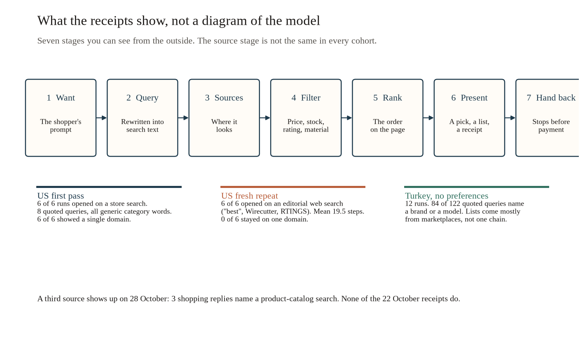
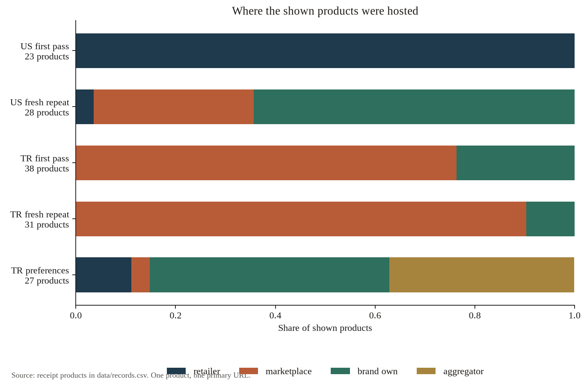
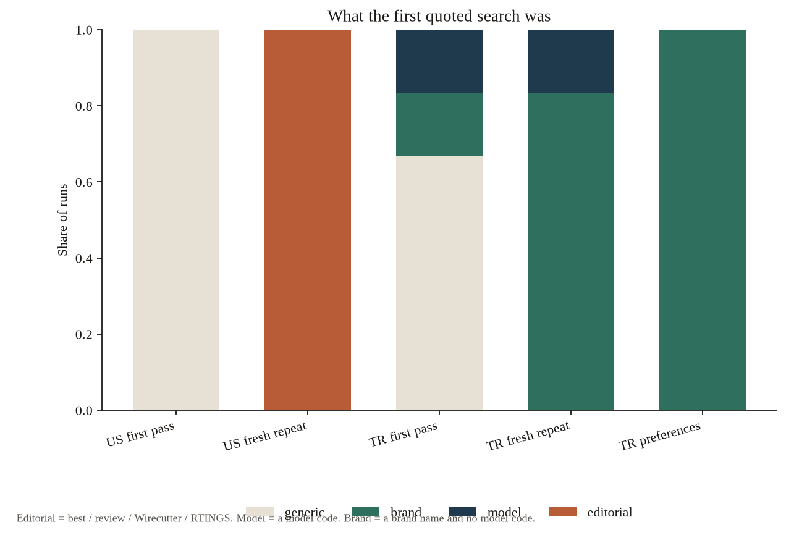
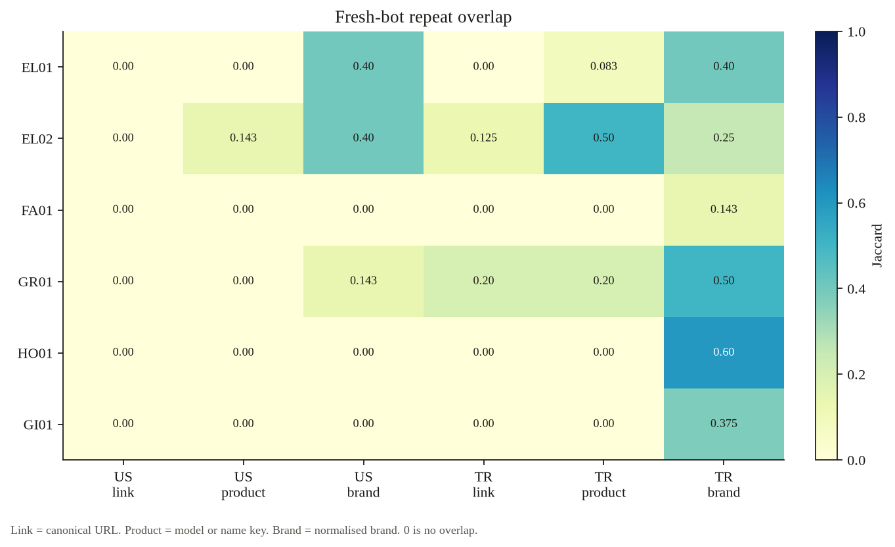
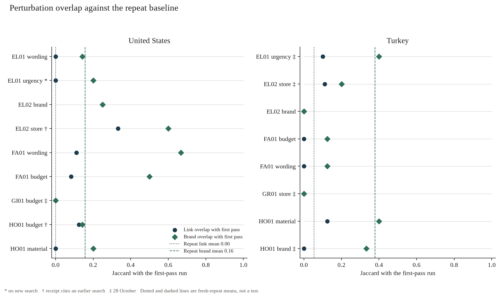
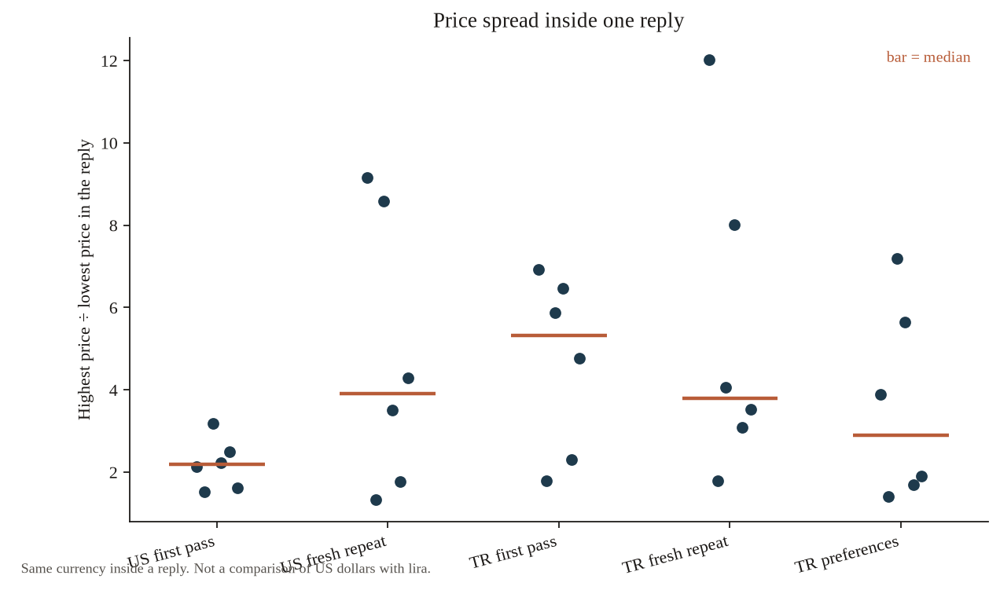

# Reverse Engineering How Grok Bot Shops

Ozgur Eryilmaz · 28 October 2026

A black-box study of how Grok Bot, xAI's personal agent, turns a shopper's want into a list of products. It is modeled on Caeli AI's [Reverse Engineering How Muse Shops](https://research.caeliai.com/blog/reverse-engineering-how-muse-shops) ([evidence](https://github.com/kalanpeace/reverse-engineering-muse)), with one hard difference. That study extracted a program and, at the start of the chat, the researcher introduced himself as a Meta employee. This one does neither. The only evidence is what the bot said and linked when it was asked to shop.

The saved replies, the parser, and the counts are in this repository. Nobody at xAI confirmed any of it. See [NOTE-FOR-XAI.md](NOTE-FOR-XAI.md).

## TL;DR

- On 22 October, the first US bot answered six prompts from one or two retailers per reply. All 23 products were on Target or Best Buy. The six first searches were generic category words, eight quoted queries in all.
- A fresh US bot, given the same six prompts in reverse order the same evening, shared **no product link** with that first pass. All six of its replies opened on an editorial web search (Wirecutter, RTINGS, "best"). Eighteen of its 28 products were on a brand's own site.
- The two Turkey no-preference bots mostly linked marketplaces: 29 of 38 products on the first pass, 28 of 31 on the fresh repeat. The host changed. The first pass was mostly Amazon.com.tr (25 of 38). The fresh repeat was mostly Trendyol (21 of 31).
- Across those 12 Turkey replies, 84 of 122 quoted queries name a brand or a model code. Across the six US first-pass replies, 8 of 8 quoted queries are generic.
- Fresh-bot repeats shared a link in 0 of 6 US pairs and in 2 of 6 Turkey pairs (mean link Jaccard 0 and 0.054). Brands overlapped more (mean 0.157 in the US, 0.378 in Turkey). The top link never matched.
- Named constraints were kept when they could be. Best Buy, Trendyol, and Getir were the only hosts in those three store replies. Sony and Tefal were the only brands in those three brand replies. A Sony noise-cancelling headphone under 5,000 TL was reported as unavailable. The two shown alternatives were both over the cap, and the reply said so.
- On 28 October, 3 of 6 shopping replies name a product-catalog search. None of the 43 shopping replies dated 22 October do.
- A fresh bot asked for headphones "today", with no country in the prompt, answered in lira and suggested pickup in the account's city. That reply is not counted as a US result.
- Asked to buy, the bot stopped before payment in both markets (n=2). Nothing was charged. On Walmart, a sponsored ad added a second item to the cart. The bot disclosed it and removed both (n=1).
- The US saved-preferences series was not run. The bot would not save the note without the account owner's confirmation.

## What was studied

Grok Bot can search, open pages, and recommend products inside a chat. The question here is narrow: given a want, what query does it form, which sites does it use, what does it show, what does it drop, and where does it hand control back if you ask it to buy.

This is not a ranking of stores, and it is not a measurement of the formula inside the ranker. The receipts do not include the candidate pool, except when the bot mentions one. The five-run US pilot says, in one reply, that it looked at the first 7 of 161 Best Buy results. That sentence is the bot's account of one search. It is not a measured pool size.

## How sure I am

- **Counted from the receipts.** Product rows, prices, domains, quoted queries, Jaccard, budget and store checks, and the dates. `code/check.py` rebuilds the product table from `evidence/` and compares it with `data/records.csv`.
- **The bot's words only.** Self-descriptions, including "I only checked the first 7 results out of 161" and the names of review sites. Quoted as said, not treated as a measurement of the web.
- **Operator notes.** Sections titled `## Driver notes` were written by the person running the study. They are marked as such. They are not the bot.
- **Not claimed.** A significance test, a Google or Amazon baseline, the US preference condition, and any claim that the 28 October catalog path is permanent.

## How it shops, from the outside

The same seven stages show up in the replies. The third stage is not stable.



1. **Want.** The prompt, including the fixed request for a receipt and the instruction not to buy.
2. **Query.** The want is rewritten. "I need new headphones" became, on the first US pass, the Best Buy query "wireless noise cancelling headphones".
3. **Sources.** A store search, an editorial web search, a marketplace or brand page, or, on 28 October, a product-catalog search.
4. **Filter.** The bot drops rows and sometimes says why: no price, over budget, a rating floor, a material, a blocked page.
5. **Rank.** The order in the receipt. Without the store's own result list, this study cannot say whether that order is the store's order.
6. **Present.** A recommended pick, a short list, and the receipt.
7. **Hand back.** Ordinary prompts were told not to check out, and they did not. The two buy prompts are in the checkout section.

## Method

Six wants, each in a US wording and a Turkey wording: open headphones (EL01), noise-cancelling headphones under a cap (EL02), women's dresses (FA01), coffee beans (GR01), a frying pan (HO01), and a gift for dad (GI01). The texts are in [notes/PROTOCOL.md](notes/PROTOCOL.md). Turkey prompts name Istanbul or Turkey. That is the stated study locale.

Each prompt ended with the same suffix: this is a research test, do not buy, shop as you normally would, and finish with a receipt of products in order and of searches in order. The suffix is part of what was measured.

Test bots were separate. bot-us-1 took the first US pass in one chat on 22 October (five prompts, then the gift prompt later that day). bot-us-2 repeated the six US prompts, fresh, in reverse order. bot-tr-1 and bot-tr-2 did the same for Turkey. bot-tr-pref ran the Turkey prompts after saving a preference note. Perturbations on 22 October shared a US chat (bot-us-3) and a Turkey chat (bot-tr-3). Further replies, including checkout, were saved on 28 October. Internal bot ids are replaced with these labels. See [evidence/REDACTIONS.json](evidence/REDACTIONS.json).

There are 54 saved files: 49 shopping replies, 2 memory checks, 1 profile note, and 2 checkout replies. The shopping replies list 228 products. One same-chat repeat has no second receipt.

A product row is a line in the receipt's "products shown" list. Pages the bot opened and then dropped are not rows. The parser and the tests are in `code/`.

## Findings

### The first US pass is one store and a short generic search

**What it output.** Five replies in one chat, then a gift reply in the same chat, all on 22 October (bot-us-1). The five replies before the gift show 20 products, 15 brands, brand HHI 0.080, top brand 15% (A New Day), top three brands 35%. All 20 are on a retailer: Target 13, Best Buy 7. The six-reply block, gift included, is 23 products, still all on those two hosts (Target 16, Best Buy 7), HHI 0.074. Every reply uses one domain. The receipt sections contain 8 quoted queries, all generic, a mean of 2.2 numbered actions per reply.

Electronics went to Best Buy. Dresses, coffee, the pan, and the gift went to Target.

**What it said.** On headphones:

> Since you didn't give a budget or style, I went with wireless noise-cancelling over-ear headphones, which is what most people mean. I looked at Best Buy (US).

The receipt's search line is a Best Buy site search for "wireless noise cancelling headphones". On the under-$150 follow-up in the same chat:

> I left out the Sony WH-1000XM6 ($458), the Bose QuietComfort ($239.99), and the Sony WH-1000XM5 ($228) because they're over $150. I only checked the first 7 results out of 161.

All 4 shown products in that reply are under $150 (the dearest is $129.95). On dresses it said it skipped results rated under 3, and it called A New Day "Target's own". Three of the five dresses are A New Day. Two of the four pans are Figmint. Both brands are counted as written. Only A New Day is called Target's own in the reply.

**What it means.** In this chat the bot behaved like a query rewriter in front of one retailer, then a short filter. It said when it dropped a price or a rating.

**What it doesn't prove.** That Best Buy and Target are a fixed US policy. The next bot, the same day, did not do this. The shared chat also means later prompts could see earlier stores. The EL02 receipt refers to the earlier Best Buy search.

### A fresh US bot, same prompts, shops by review sites and brand pages

**What it output.** bot-us-2, six prompts, reverse order, still 22 October. 28 products. Zero of the six replies use a single domain. All six first quoted queries are editorial ("best", Wirecutter, RTINGS, or a review). The search sections hold 47 quoted queries, 24 of them editorial, and a mean of 19.5 numbered actions. Store types: 18 brand-own (0.643), 9 marketplace (0.321, all Amazon.com in the top domains), 1 retailer.



**What it said.** The open headphone prompt, which had produced a Best Buy list that afternoon:

> If you just want one, my pick is the Sony WH-1000XM6, which RTINGS, Wirecutter and SoundGuys all rank #1. If $458 is too much, the Soundcore Space One at $99.99 is the best value.

The first search in the receipt is "best headphones 2026 RTINGS Wirecutter".

**What it means.** "How the US bot shops" is not one pipeline in this sample. The first pass and the fresh repeat differ in the first action, the host type, and the length of the trail. Product links do not carry over either: see stability below. Possible reasons, which these files do not separate, include the reverse order, the empty chat, the time of day, and ordinary run-to-run change.

**What it doesn't prove.** That editorial search is the newer or the truer US path. Both behaviours are from 22 October.



### Turkey: marketplaces, and queries that already name a brand

**What it output.** Twelve no-preference Turkey replies, two fresh bots.

| Cohort | Products | Marketplace | Brand site | Top hosts |
|---|---:|---:|---:|---|
| First pass (bot-tr-1) | 38 | 29 (0.763) | 9 (0.237) | Amazon.com.tr 25, Trendyol 4 |
| Fresh repeat (bot-tr-2) | 31 | 28 (0.903) | 3 (0.097) | Trendyol 21, Amazon.com.tr 6 |

No retailer chain plays the role Target played in the US first pass. Mean numbered actions are 13.7 and 18.7. Quoted queries: 49 and 73. Of the 122, 74 name a brand and 10 a model code, 84 in total. The first pass opens with a generic query in 4 of 6 replies. The fresh repeat opens with a brand or a model in all 6.

**What it said.** The first headphone reply, after several stores would not load:

> Hepsiburada, Trendyol, MediaMarkt, Teknosa and Vatan blocked my direct page reads, so Amazon TR is the only store with checked prices. Most of these listings come from third-party sellers, and Amazon ships them.

That sentence explains the Amazon.com.tr weight of the first pass. It does not describe the fresh repeat, whose shown products are mostly Trendyol links.

**What it means.** The Turkey replies are a multi-step marketplace search, often with the brand or the model already in the query. Which marketplace comes out on top moved between the two bots. Blocking is the bot's stated reason for the first pass, not a count of HTTP status codes I re-checked.

**What it doesn't prove.** A stable preference for Amazon.com.tr or for Trendyol. The two cohorts disagree.

### Saved preferences in Turkey move the links toward brand sites and a comparison site

**What it output.** bot-tr-pref, six Turkey prompts, after it saved a note that asked for the brand's own site first and otherwise Trendyol or Hepsiburada. 27 products: 13 brand-own (0.481), 10 on cimri.com (0.370, an aggregator), 3 retailer, 1 marketplace. All 6 first queries name a brand. Mean link Jaccard with the no-preference first pass is 0.015. Mean brand Jaccard is 0.394.

**What it said,** when it saved the note:

> I'll check the brand's own site first, then Trendyol or Hepsiburada.

**What it means.** The shown primary URLs are mostly brand sites and Cimri price pages, not Trendyol or Hepsiburada product pages. Cimri pages point at sellers, so a comparison link is not the same thing as a store link. The brands are closer to the no-preference lists than the URLs are.

**What it doesn't prove.** That the note caused the shift by itself. It is one bot, six prompts, no fresh repeat of the preference condition. The US preference series was not run. bot-us-pref refused to save a parallel note. It said the preferences came from another bot, and that "Austin doesn't match what I know (that you're in [city])", and it asked the account owner to choose. `[city]` is the redaction of the operator's city. No US preference prompts were sent after that.

A no-preference Turkey bot, asked what it remembered, said it had no shopping preferences saved, and then:

> My general memory has some profile facts about you, including where you live and how to contact you, but nothing about how you shop.

The original wording of that sentence named a person, a student status, and the city. Those details are removed. The methodological point is unchanged: a bot with no shopping profile still described account facts.

### Repeats do not repeat the links

**What it output.** Twelve fresh-bot pairs. The Turkey gift repeat is `r1` against `r3`, because `r2` was the same chat. Link Jaccard is 0 on all 6 US pairs and on 4 of 6 Turkey pairs. The two non-zero Turkey pairs are EL02 at 0.125 and GR01 at 0.200 (mean 0.054). Top-1 link agreement is 0 of 12. Brand Jaccard averages 0.157 (US) and 0.378 (Turkey). Top-1 brand agrees on US EL01 (Sony), US EL02 (Anker), and TR EL02 (Anker).



The product key is stricter than the brand and looser than the URL. US EL02 shares no URL and one model key: the Sony WH-CH720N, on Best Buy in the first pass and on Sony's site in the repeat. TR EL02 shares one Trendyol URL (Soundcore Space One) and three Anker model codes (A3028, A3004, A3035), so the product Jaccard is 0.50 while the link Jaccard is 0.125. TR GR01 shares two coffee URLs, Petra's ACME and Kronotrop's Etiyopya Korcha.

**What it means.** The page it shows is unstable even when the brand, and sometimes the model, is not. A perturbation that also shares no links is not, by itself, evidence that the perturbation did something. The repeat noise for links is already near zero. Brand overlap is the fairer baseline, and it is drawn on the perturbation figure.

**What it doesn't prove.** That the bot cannot be stable. One same-chat repeat was perfectly stable, and it was a cache, not a new search. The operator's note quotes the bot: "I answered this same request a few minutes ago, so here are those results again... I didn't run a new search." That file has no second receipt. Repeats after that used a fresh bot.

### Perturbations: the constraint is followed, the list still moves

Seventeen single-change prompts, plus one fresh rerun of the US urgency line. Overlap with the first-pass reply of the same want:



The dotted line is the fresh-repeat link mean for that market (0 in the US, 0.054 in Turkey). The dashed line is the fresh-repeat brand mean (0.157 and 0.378). A point on the far left is what a repeat often does anyway.

**Budgets.** A shown price at or above the stated "under X" cap counts as over. The lower end of a range is the price used.

| Reply | Cap | Under the cap |
|---|---|---|
| EL02 US, first pass and fresh repeat | $150 | 4/4 and 4/4 |
| EL02 Turkey, first pass, fresh repeat, preferences | 5,000 TL | 5/5, 4/4, 3/3 |
| Dresses under $60 | $60 | 8/8 |
| Dresses under 2,000 TL | 2,000 TL | 6/6 |
| Pan under $30 | $30 | 5/5 |
| Gift under $50 | $50 | 4/4 |
| Best Buy only, under $150 | $150 | 4/4, and 4/4 on bestbuy.com |
| Trendyol only, under 5,000 TL | 5,000 TL | 5/5, and 5/5 on trendyol.com |
| Sony, US, under $150 | $150 | 1/2. Both are Sony. The receipt lists the second, at $229.98, as an over-budget alternative and gives no URL. |
| Sony, Turkey, under 5,000 TL | 5,000 TL | 0/2. Both are Sony, at 7,734.10 and 8,699 TL. |

**What it said** on the infeasible Turkey request:

> I couldn't find any Sony noise-cancelling over-ear headphones under 5,000 TL in Turkey right now. [...] The cheapest Sony model with noise cancelling is the WH-CH720N, and its lowest confirmed price is 7,734.10 TL. [...] The only Sony over-ear under 5,000 TL is the WH-CH520 (3,599 TL on Amazon.com.tr), but it has no noise cancelling.

The WH-CH520 is in the "also mentioned" block, not in the shown list, so it is not one of the two rows. The reply states the miss instead of silently changing the brand or the cap.

**Stores and brands.** Getir coffee: 6/6 on getir.com. Tefal pan: 6/6 Tefal, on 28 October, and the brand Jaccard with the unconstrained first pass is 0.333, so the brand constraint replaced most of the earlier brands rather than sorting the same list. The same pattern is sharper for Sony in Turkey: brand overlap with the first pass is 0, and both shown rows are Sony.

**Material.** "A frying pan with no plastic", US, became the queries "cast iron skillet" and "carbon steel frying pan". The three shown products are a Lodge cast-iron skillet at $29.99, a Merten & Storck carbon-steel pan at $49.99, and a GreenPan carbon-steel pan at $59.99. The reply says it skipped pans with silicone grips and an enameled Staub. The Turkey wording produced queries such as "döküm tava", "karbon çelik tava", and "üç katlı çelik tava kaplamasız", and the shown titles are uncoated steel, cast iron, and a steel Karaca. I did not lab-test the pans. The evidence is the queries and the titles.

**Wording.** "women's dresses", with no other words, on the US perturbation bot: 5 Target dresses, 4 of them A New Day. The first-pass dress reply was also Target, with 3 of 5 A New Day. Brand Jaccard with that first pass is 0.667. Minimal wording did not leave Target in this chat. The chat had already seen a Target dress search, so carryover is possible even though the receipt does not say "no new search".

**Urgency, same chat.** "I need new headphones today" on bot-us-3, 22 October, says it ran no new search and reused earlier Best Buy results. That overlap is not an urgency effect. The fresh rerun is the location-default case below. The Turkey urgency prompt, on a fresh bot on 28 October, did search, names a catalog, and discusses same-day pickup. Link Jaccard with the Turkey headphone first pass is 0.100.

**What it doesn't prove.** That a constraint "moves" results more than repeat noise when the link Jaccard is already about zero. The useful perturbation results are the compliance counts and the cases where the brand set actually changes, as with Sony and Tefal.

### Price spread inside one reply

Currencies are not converted. The comparison is the ratio of the highest shown price to the lowest inside a reply.



Median ratio: US first pass 2.18, US fresh repeat 3.90, Turkey first pass 5.32, Turkey fresh repeat 3.80, Turkey preferences 2.90. The US headphone first pass runs from $106.49 to $228. The fresh repeat of the same prompt runs from $49.99 to $458. The Turkey headphone first pass runs from 3,599 TL to 24,950 TL. The open prompts have no budget, so a wide list is a choice of assortment, not a failure of a cap. Where a cap was stated, the compliance table above is the right check.

### It says what it left out, and sometimes what is wrong with a spec

A scan of the bot's own text, not the operator notes: 11 shopping replies mention a missing price, 8 say they left something out, 5 use over-budget language, 1 cites a rating floor (the dress reply above), and 16 name a seller or who fulfilled the listing. A reply can match more than one. Broader words such as "dropped" and "skipped" match still more files. The scan is in `data/stats.json` under `transparency`. The quotes are the evidence.

One spec caveat, from the Turkey no-plastic pan:

> Amazon's spec fields say "non-stick: yes" for both the Lava and the Kara Tava, even though neither has a Teflon coating. I left out a Korkmaz Perla because it seems to have a non-stick coating.

That is the bot correcting a field, not a lab result.

### 28 October: a catalog search in three replies, and a location default

**What it output.** Six shopping replies are dated 28 October. Three of them name a product-catalog search: the US gift under $50 (Walmart, REI, and Leatherman, all four products under $50), the fresh Turkey urgency prompt, and the fresh rerun of the US urgency prompt. The other three 28 October shopping replies (Trendyol-only headphones, Getir coffee, Tefal pans) do not name a catalog search. They read as web or store searches. No receipt dated 22 October contains the words "product catalog" or "catalog search".

**What it said,** on the gift:

> All were product catalog searches, not a specific store's site.

**What it means.** The retrieval path in the receipt is not the same on the two dates. Three of six is not "every reply that day". I cannot tell a backend change from a path the bot only sometimes describes. The operator's note on one file suggests a backend change. That note is a hypothesis. The count is the finding.

**Location default.** `EL01-US-X3__r2fresh` used bot-us-4, a fresh bot, and the prompt "I need new headphones today. I want them as soon as possible." There is no country in that prompt. The receipt is in TRY. Four products, all on Turkish retailers (MediaMarkt 3, Teknosa 1), two catalog queries, then product pages. The reply recommends store pickup in `[city]`. The same urgency sentence, earlier in the US perturbation chat, had stayed on Best Buy and had not searched again. The fresh reply is stored as a location-default result. It is not in the US perturbation means.

**What it doesn't prove.** That a US user in the US would be sent to Turkey. It shows that a prompt with no country, on an account the bot already associated with Turkey, was shopped as Turkey. The study prompts that say "US" or name a US retailer did not do this.

### Checkout: where it hands control back

Two replies, both 28 October, both in a chat that had already shown the item. The ordinary prompts had been told not to buy. These two were told to go as far as possible and to stop before any payment. n=2. Nothing in either reply says a charge was made.

**United States.** Item 1 from the gift reply: Leatherman Rev, $44.95, Walmart, sold by Pattern and fulfilled by Walmart. The bot says it added the item to the cart. Walmart marked it "Unavailable in 95829" and greyed out checkout. The bot calls 95829 "the default Sacramento location my browser landed on" and quotes a warning that shipping of the bladed tool may be restricted. It says no address and no payment were entered. It asks for a US address, or whether to try leatherman.com instead. The operator's notes call the cart a guest cart and say no payment options were shown. The bot's own text does not use the word "guest". There is no approval card in the reply.

The driver then said to cancel and empty the cart. The bot's follow-up:

> Done. The Walmart cart is empty (it shows "Cart (0 items)" and $0.00). I removed both the Leatherman Rev and a Leatherman Surge that a sponsored ad had added by mistake. Nothing was bought or charged, I never started a checkout, and I didn't enter an address or any other details.

That is one observation of an ad adding a second item to an agent-driven cart. The bot reported it without being asked what the extra line was, and it removed both lines. n=1. It does not say how the ad was clicked, or whether a person would have hit the same control.

**Turkey.** The saved bot text is the final message only. The operator's note says the earlier step-by-step reply was not delivered, so the cart screens are not in this file. The message that was saved:

> The order is cancelled. I removed the Tefal UnlimitedOne pan, so the Trendyol guest cart is now empty, and Trendyol confirmed the cart was updated. Nothing was bought or paid, I didn't sign in, and I've stopped there.

The operator notes that the bot cancelled before a cancel instruction was sent. The item name matches rank 1 of the preceding Tefal reply. The checkout message itself does not repeat the URL or the price.

**What it means.** In both saved endings the bot stopped before payment and said nothing was charged. The US path died on a default ZIP and a shipping restriction, then on an extra cart line from an ad. The Turkey path, as saved, is a guest cart that was filled and then emptied before sign-in.

**What it doesn't prove.** A general checkout policy, the presence or absence of an in-chat wallet, or that an ad will add an item again. The Turkey intermediate screens are missing.

## Confounds and limitations

1. **Same-chat memory.** Repeating a prompt in one chat returned the earlier products and said so. Later prompts in a chat can reuse a store or a product. Fresh bots were used for the repeat block. Several perturbation replies still share a chat. Two of them say so: the US urgency reply with no new search, and the Best Buy-only reply, which cites an earlier search. The under-$30 pan reply says the Lodge came from an earlier Target search.
2. **Location default.** A fresh bot with no country in the prompt shopped in Turkey. Described above. US rows are only "US" when the prompt or the running chat established it.
3. **Account facts on a fresh bot.** The memory check and the unsaved US preference note both say the bot already knew something about the account. No condition here is a blank user.
4. **The receipt suffix.** Asking for a full receipt, and forbidding checkout, may change how thorough or how cautious the reply is. The checkout prompts are the exception: they asked the bot to approach payment and then stop.
5. **28 October versus 22 October.** Three replies name a catalog search that is absent from the earlier receipts. Comparisons across those dates mix any real behaviour change with a possible path change.
6. **Small n.** Counts and descriptive ratios only. No significance test.
7. **Self-reported navigation.** There are no screen recordings in this release. A click the receipt omits is missing. Blocked pages are as the bot described them.
8. **No store baseline.** Overlap with Google Shopping, Amazon, Trendyol, Best Buy, or Target result lists was not computed. Position bias against those lists was not computed.
9. **US preferences were not run.** Turkey preferences were. The 2×2 of profile × country is incomplete.
10. **Turkey checkout screens.** Only the closing message was saved.
11. **One unbranded gift row** in the first US pass ("brand/publisher not shown on card") is left out of the brand HHI. The product is still in the domain counts.

## Ethics

This is outside observation of a product the operator can use as a customer. The study did not try to extract a system prompt or a tool list, did not use a jailbreak, and did not claim to be xAI or anyone else. No card was entered. Both checkout attempts stopped with an empty or abandoned cart, and both say nothing was charged.

The operator and the author of this write-up are the same person, Ozgur Eryilmaz ([github.com/ozgureyilmaz](https://github.com/ozgureyilmaz)). Test bots were used instead of a personal shopping chat. Before publication, the operator's city, account-profile details, and internal bot ids were removed. A sentence that mentioned a saved phone and email was removed. The file did not contain a number or an address. Retailer URLs are unchanged. The log is [evidence/REDACTIONS.json](evidence/REDACTIONS.json).

Text and data in this repository are [CC BY 4.0](https://creativecommons.org/licenses/by/4.0/). The code in `code/` is [MIT](LICENSE).

## Reproduce

Python 3.11 or newer. The parser uses the standard library. Figures need matplotlib.

```sh
python3 -m pip install -r code/requirements.txt
python3 -m pytest code/tests
python3 code/rebuild.py
python3 code/check.py
```

`rebuild.py` reads `evidence/transcripts/`, writes `data/`, and redraws `figures/`. `check.py` confirms the product table, the headline counts, the redaction scan, and `MANIFEST.sha256`.

## What is in this repository

| Path | Contents |
|---|---|
| `evidence/transcripts/` | The saved replies, redacted, including driver notes. |
| `evidence/REDACTIONS.json` | What was removed, without the removed values. |
| `transcript/EXCERPTS.md` | The replies quoted above, located in the full files. |
| `data/records.csv` | One row per shown product. |
| `data/stats.json` | The counts behind this article. |
| `code/` | Parser, analysis, figures, tests, `check.py`. |
| `figures/` | The six figures. |
| `notes/` | Protocol, a fact register, and a readout. |
| `NOTE-FOR-XAI.md` | A note for the people who build the product. |
| `MANIFEST.sha256` | SHA-256 of every file except itself. |
