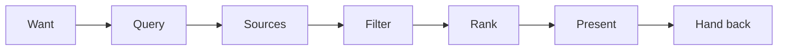
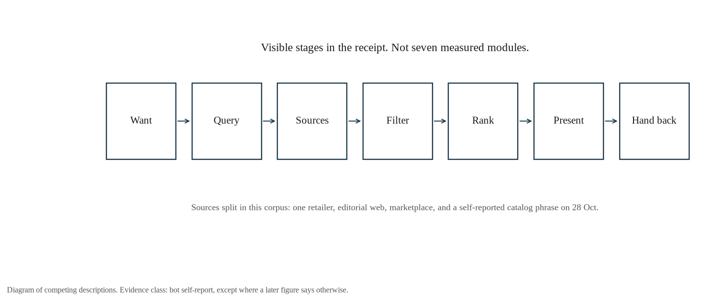
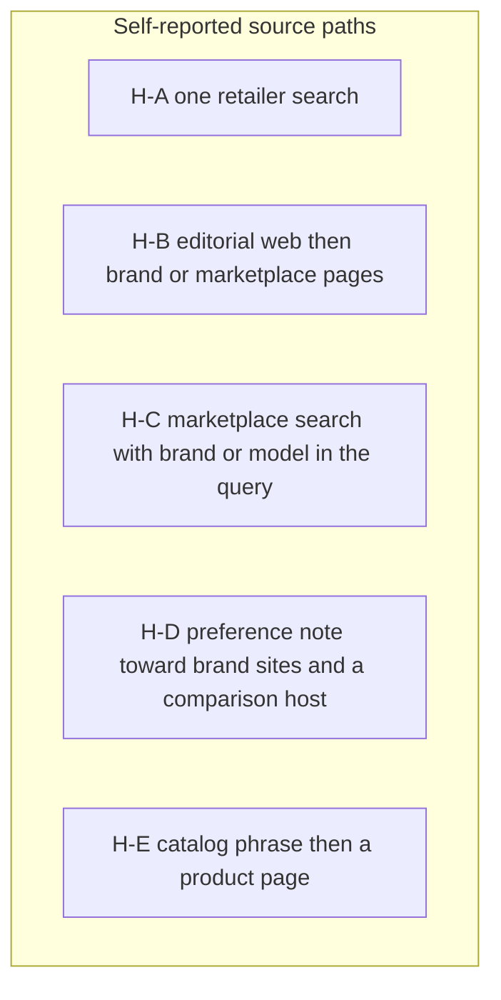

# Architecture analysis

Evidence classes are named in each section. Receipt text is never an execution trace. This file is rebuilt from `v2/normalized/analysis.json` and `v2/config/public_docs.yaml`.

## What can be seen from outside

The receipt shows seven stages. They are a description of the text, not seven measured modules.

1. **Want.** The prompt, including the fixed receipt suffix and the instruction not to buy.
2. **Query.** The receipt quotes search text. That text is often more specific than the prompt. The quote is the bot's report of what it searched.
3. **Sources.** The receipt names a site search, a web search, an editorial page, a marketplace, or, on some 28 October replies, a product-catalog search.
4. **Filter.** The bot sometimes says it dropped a row for price, rating, stock, or material. The dropped set is otherwise unobserved.
5. **Rank.** The order of the receipt list. Without the candidate set, that order cannot be compared with a store's own order.
6. **Present.** A short list and the receipt.
7. **Hand back.** Ordinary prompts were told not to check out. Two later prompts were told to stop before payment. Both saved endings say nothing was charged. n=2, and both are self-reports.

## What looks stable, and what moves

| Stage | In this corpus | Reading |
|---|---|---|
| Constraint filter | Store, brand, and budget constraints on the shown rows are kept, with the stated Sony-plus-budget misses | Looks more regular than link identity. n is small and several prompts share a chat. |
| Source choice | US first pass is one retailer. US fresh pass opens on editorial queries. Turkey passes are marketplaces. Three 28 October replies say catalog. | Not one pipeline. |
| Rank of URLs | Fresh repeats share a top link in 0 of 12 pairs | Unstable across these bots. |
| Hand-back | Both checkout endings stop before payment | Two self-reports. Not a measured policy. |

Deterministic and stochastic are the wrong pair of words for most of this. A stage can be sensitive to the chat, the account, and the day, which is not the same thing as a coin flip, and this design cannot separate those.

## Competing hypotheses

| Id | Hypothesis | What matches | Confidence | What would verify it |
|---|---|---|---|---|
| H-A | The bot rewrites the want and searches one retailer | us-r1 only. Top domains target.com 16, bestbuy.com 7. | Low as a general US path. High as a description of that chat. | A tool log showing one host and the result list, for more than one fresh bot. |
| H-B | The bot searches the web for reviews, then opens brand or marketplace pages | us-r2. First-query styles: {'editorial': 6}. | Low as "the" US path. High as a description of that bot. | The same, plus the result list of the quoted query from an independent index. E01 and the baseline harness. |
| H-C | Turkey shopping is a multi-step marketplace search, often with a brand already in the query | tr-r1 and tr-r2, which disagree on the host. | Moderate for "marketplace URLs", low for a preferred host. | Fresh bots in E01-TR, with HTTP checks of pages the receipt says were blocked. |
| H-D | A saved preference note shifts the primary URL toward brand sites | pref-tr, one bot. | Low as a cause. | E05, including refusals. |
| H-E | A catalog search was available on 28 October | The phrase appears in 3 replies, all on that date: EL01-TR-X1__r1fresh, EL01-US-X3__r2fresh, GI01-US-X1__r1. | Low. The phrase is verified. The tool is not. | A first-party log that a catalog index was queried, with the index's name as the system uses it. Public docs retrieved 28 October 2026 do not describe it. |
| H-F | With no country in the prompt, the bot uses account locale | `EL01-US-X3__r2fresh` only. | Low beyond that reply. | E01 runs that deliberately omit the country, on accounts whose locale is known to the operator. |
| H-G | Link identity is unstable even when the prompt is fixed | The 12 fresh pairs. | High for these pairs. The rate is what E01 is for. | E01. |

## Location, memory, preferences

Public documentation says a bot keeps stable preferences and that name and time zone are shared across the account's bots, while other memory is per bot (`DOC-BOTS`, `DOC-OVERVIEW`). It also says phone location, when requested in the person's own mobile chat, is a position rather than an address (`DOC-MOBILE`). None of that says which country a desktop shopping prompt uses when the prompt names none.

In the corpus, a no-preference Turkey bot said it had account facts and no shopping preferences. The US preference note was refused because a city in the note did not match a city the bot already associated with the account. The city is not in this repository. The methodological point is that "fresh bot" was not a blank account.

## Checkout handoff

`DOC-COMPUTER` says checkout can use a Vault card, a Secure Form, or a wallet such as Link or X Money. The changelog entry of 22 October 2026 says bots can pay with Shop Pay. The 26 October 2026 entry says the person still approves every purchase. The two saved endings in this corpus stop before payment and say nothing was charged. One of them says a sponsored ad added a second Walmart line, which the bot then removed. That is one self-report (`CHECKOUT-US`). It is not a rate.

## First-party evidence that would decide the source path

A log of each retrieval call the bot actually made: the arguments, the time, the candidate rows before filtering, and the rows dropped, using the system's own names. A screen recording would check the receipt against the pages. Neither is in this repository. This study did not try to obtain hidden instructions.

## Public documentation

### DOC-OVERVIEW

<https://docs.x.ai/grok-bot/overview>

Supports:
- Grok Bot is described as working on a persistent cloud computer with a browser, filesystem, and terminal.
- The bot takes on multi-step work across apps and websites and comes back when something needs approval.
- Memory is described as stable preferences, role context, and summaries of prior work. Name and time zone are described as shared across the account's bots. Other learned context is described as separate per bot.
- A site can block automation. The page says the bot hands those steps back rather than working around them.

Does not support:
- No product-catalog search, no ranking formula, and no retailer contract is described on this page.

### DOC-COMPUTER

<https://docs.x.ai/grok-bot/computer-and-apps>

Supports:
- At checkout, the page says the bot can use a card saved in Vault, a card entered in a Secure Form, or a connected wallet such as Link or X Money.
- Browser sessions are described as persistent and shared across the account's bots.

Does not support:
- The page does not name a product catalog. The words 'product catalog' and 'catalog search' were not on the page when it was retrieved.

### DOC-BOTS

<https://docs.x.ai/grok-bot/bots>

Supports:
- A bot is described as keeping preferences, rules, name, time zone, and a dated work log.
- Logins, cards, and contact details such as addresses and phone numbers are described as belonging in Vault, not in memory.
- The page says a bot decides on its own when something is worth keeping, and that memory is not a source of truth.

Does not support:
- No shopping ranker is described.

### DOC-MOBILE

<https://docs.x.ai/grok-bot/mobile>

Supports:
- Phone location, when the bot is asked and the person is in their own chat, is described as a position, not an address or a place name.

Does not support:
- This does not say what locale a desktop bot uses when a shopping prompt names no country.

### DOC-CHANGELOG

<https://x.ai/changelog/bot>

Supports:
- 22 October 2026 entry: bots can pay with Shop Pay, through Shop checkout where a store accepts it, and with a one-time Shop card elsewhere.
- 26 October 2026 entry: the Vault has a Payments tab for the method bots try first, and the person still approves every purchase.
- 25 September 2026 entry: bots use built-in guides with direct links and steps for popular travel, food, shopping, and shipping sites.

Does not support:
- The changelog retrieved on 28 October 2026 does not mention a product-catalog search.
- A built-in guide for shopping sites is not evidence of a commercial ranking deal.

### DOC-GUIDE-101

<https://x.ai/bot/guides/grok-bot-101>

Supports:
- A 11 September 2026 guide by Matt Palmer describes Grok Bot as an agent with a cloud computer that can browse and use apps.
- The guide says the author asked a bot to look at Costco and Amazon, add items to a cart, and compare prices, delivery charges, and times.
- The guide says the bot can hand the desktop back for a CAPTCHA or a 2FA login.

Does not support:
- The guide is an example, not a specification of ranking or of which retailers are preferred.

### DOC-API-SEARCH

<https://docs.x.ai/developers/tools/web-search>

Supports:
- The xAI API documents a developer tool whose name on that page is web_search. The page is about the API, updated in the page's own 'last updated' line, and it is a different surface from the Grok Bot chats in this study.

Does not support:
- This study does not treat that API name as the name of a tool the shopping bot called. No execution trace was collected.

Those phrases were not present on the pages retrieved on 28 October 2026. That is not a proof that no such page exists anywhere.
